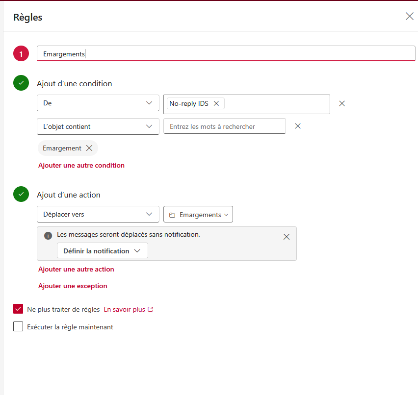

# cnamsign

Automatisation de l'émargement sur la plateforme CnamSignE à partir des codes reçus par e-mail sur Outlook Le Cnam.

## Prérequis

### 1. Boîte de réception Outlook

Dans Outlook Web ([outlook.office.com](https://outlook.office.com)) :

1. Créer un sous-dossier nommé `Emargements` (sans accent, E majuscule et s à la fin).
2. Créer une règle de boîte de réception (Paramètres > Courrier > Règles > *Ajouter une nouvelle règle*) :
   - **Nom de la règle** : `Emargements`
   - **Conditions** :
     - **De** : `No-reply IDS`
     - **L'objet contient** : `Emargement`
   - **Action** :
     - **Déplacer vers** : le dossier `Emargements`
   - **Options** : cocher *Ne plus traiter de règles*



Si un autre nom de dossier est utilisé, il suffit de le renseigner dans la variable `OUTLOOK_FOLDER` du fichier `.env`.

### 2. Plateforme CnamSignE

Sur la plateforme CnamSignE (cnamsigne.lecnam.net) :

1. Se connecter avec vos identifiants Le Cnam et saisir votre code PIN.
2. Enregistrer au préalable votre signature manuscrite :
   - Cliquer sur votre nom en haut à droite pour ouvrir le menu utilisateur.
   - Sélectionner **Signature enregistrée**.
   - Tracer et sauvegarder votre signature.

Cette signature sera automatiquement réutilisée par le script lors de la validation (*« Utiliser la signature enregistrée »*).

## Configuration

Copier le template de configuration :

```bash
cp .env.example .env
```

Renseigner les variables dans `.env` :

```env
EMAIL=prenom.nom.auditeur@lecnam.net
PASSWORD=mon_mot_de_passe
PIN_CODE=1234
OUTLOOK_FOLDER=Emargements

# Notifications Discord (optionnel)
DISCORD_WEBHOOK_URL=https://discord.com/api/webhooks/...
DISCORD_USER_ID=123456789012345678
STUDENT_NAME=Nadhir HALES
```

- `EMAIL` : adresse e-mail Le Cnam (commune à Outlook et CnamSignE).
- `PASSWORD` : mot de passe du compte Le Cnam (SSO Shibboleth).
- `PIN_CODE` : code PIN secret à saisir sur le clavier virtuel pour valider l'émargement.
- `OUTLOOK_FOLDER` : nom du dossier dans lequel sont rangés les mails d'émargement.
- `DISCORD_WEBHOOK_URL` *(optionnel)* : URL du webhook Discord pour recevoir un rapport à chaque émargement (succès ou échec).
- `DISCORD_USER_ID` *(optionnel)* : ID Discord de l'élève pour être mentionné (@pseudo) lors des notifications.
- `STUDENT_NAME` *(optionnel)* : Nom affiché dans le récapitulatif (si omis, déduit de l'adresse e-mail).

## Notifications Discord (Webhook)

Le service peut notifier en direct un salon Discord à chaque détection d'émargement :
- 🟢 **En cas de succès** : Confirmation que votre présence a été enregistrée (nom du cours, élève, code et heure).
- 🔴 **En cas d'échec** : Alerte immédiate avec mention `@vous` pour vous prévenir d'aller émarger manuellement avant la fin du créneau.

### Tutoriel de configuration :

1. **Créer le Webhook sur Discord** :
   - Clic droit sur le salon Discord de votre choix > **Modifier le salon**.
   - Onglet **Intégrations** > **Webhooks** > **Nouveau webhook**.
   - Nommez-le (ex: *CnamSignSignSigner*) et cliquez sur **Copier l'URL du webhook**.
2. **Récupérer votre identifiant Discord (pour le ping / mention)** :
   - Ouvrez les *Paramètres utilisateur* Discord (roue crantée en bas à gauche) > **Avancés**.
   - Activez le **Mode développeur**.
   - Faites un clic droit sur votre profil Discord > **Copier l'identifiant d'utilisateur** (suite de chiffres).
3. **Ajouter dans votre `.env`** :
   ```env
   DISCORD_WEBHOOK_URL=https://discord.com/api/webhooks/...
   DISCORD_USER_ID=123456789012345678
   STUDENT_NAME=Nadhir HALES
   ```
   *(Si `DISCORD_WEBHOOK_URL` est vide, les notifications sont désactivées sans impacter le service).*
4. **Tester l'envoi** :
   ```bash
   # Test de confirmation de succès :
   python tests/test_discord.py

   # Test d'alerte d'échec (avec mention / ping) :
   python tests/test_discord.py error
   ```

## Tests préalables

Avant de lancer le démon en continu, des scripts situés dans `tests/` permettent de tester chaque étape indépendamment.

### 1. Tester la lecture du mail
Vérifie la connexion à Outlook Web, l'accès au dossier et l'extraction du dernier code à 6 chiffres :

```bash
docker compose run --rm cnamsign python tests/test_mail.py
```

### 2. Tester la connexion SSO
Vérifie la connexion à CnamSignE et enregistre une capture d'écran dans `screenshots/test_login_result.png` :

```bash
docker compose run --rm cnamsign python tests/test_login.py
```

### 3. Tester la signature d'émargement
Vérifie la saisie du code de session, le choix de la signature et la validation :

```bash
docker compose run --rm cnamsign python tests/test_sign.py [CODE_6_CHIFFRES]
```

Ou en local avec Python :

```bash
python tests/test_sign.py [CODE_6_CHIFFRES]
```

### 4. Tester la notification Discord
Vérifie le bon fonctionnement du webhook et de la mention :

```bash
python tests/test_discord.py
```

## Déploiement Docker

Pour construire et lancer le conteneur en tâche de fond :

```bash
docker compose up -d --build
```

Pour consulter les logs d'exécution en direct :

```bash
tail -f logs.txt
# ou via Docker :
docker compose logs -f --tail 50
```

Pour arrêter le conteneur :

```bash
docker compose down
```

Le profil navigateur (cookies, cache et tokens de session) est stocké localement dans `browser_profile/` pour éviter les ré-authentifications systématiques.
